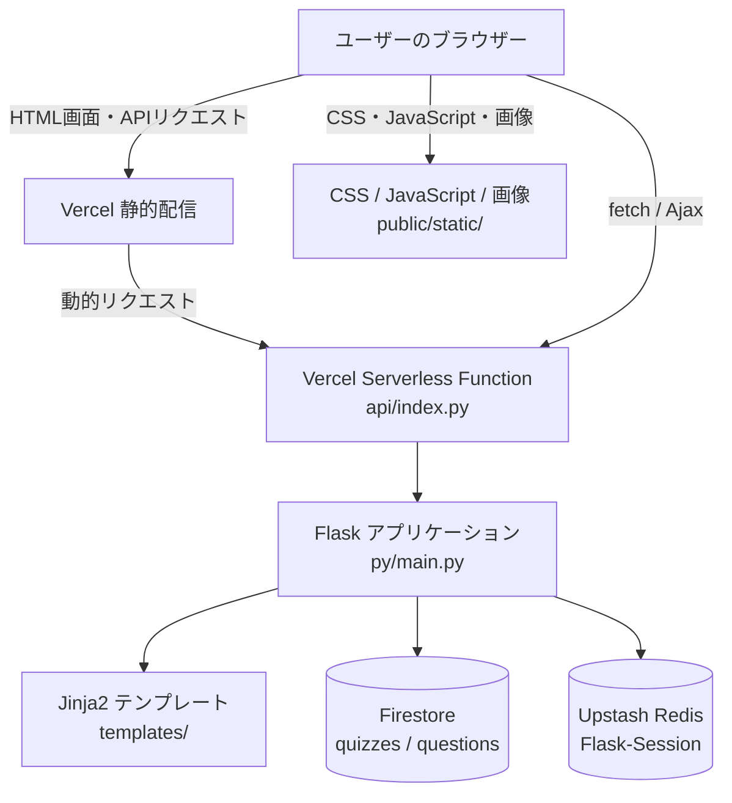

# Mondo アーキテクチャ

## 概要

Mondoは、Flaskをバックエンドにした四択クイズWebアプリケーションです。  
クイズの問題・選択肢・解説などはPythonモジュールで管理し、出題範囲や進行状況、回答結果はユーザーごとのセッションに保持します。本番環境ではセッションストアとしてRedisを使用します。

## システム構成

## アカウント

ホームからアカウント画面に移動し、Firebase Authentication のメール／パスワードまたは Google で登録・ログインできます。認証状態はブラウザーの Firebase Web SDK が管理し、Redis のクイズ進行セッションとは別です。ユーザー作成クイズは Firestore の `questions` コレクション（`source: user`, `status: published`）に保存し、作成直後に公開されます。作成・一覧・更新・削除は `/api/my_quizzes` を通じて Flask が Admin SDK で行い、所有者以外の更新・削除と、公式問題（`source: official`）の更新・削除は拒否します。Firestore のセキュリティルール（`firestore.rules`）はクライアントからの直接アクセスをすべて拒否します。旧 Supabase のデータは Firestore に移行済みのため、移行用のスクリプトは削除しました。

Firebase コンソールで両方のログイン方法を有効化し、使用する本番・開発ドメインを Authentication の承認済みドメインに追加してください。Web SDK の公開設定は `public/static/firebase_init.js` にあります。サーバー用の認証情報は含めないでください。

パスワード要件は Firebase Authentication のパスワードポリシーから取得して表示します。パスワード変更とアカウント削除では本人確認を行い、削除されるのは Firebase Authentication のアカウントです。Firestore にユーザーデータを保存する機能を追加する際は、アカウント削除に合わせたデータの削除・保持方針を別途実装する必要があります。

削除時に表示される本人確認方法は、その Firebase アカウントに連携済みの方法に限られます。削除後もブラウザーや Google に保存されたログイン候補は自動的に削除されません。
