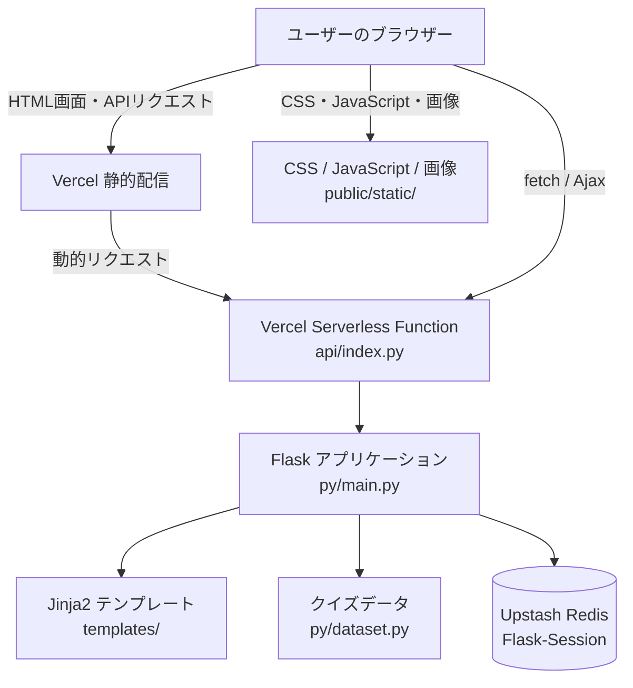

# Mondo アーキテクチャ

## 概要

Mondoは、Flaskをバックエンドにした四択クイズWebアプリケーションです。  
クイズの問題・選択肢・解説などはPythonモジュールで管理し、出題範囲や進行状況、回答結果はユーザーごとのセッションに保持します。本番環境ではセッションストアとしてRedisを使用します。

## システム構成

## アカウント

ホームからアカウント画面に移動し、Firebase Authentication のメール／パスワードまたは Google で登録・ログインできます。認証状態はブラウザーの Firebase Web SDK が管理し、Redis のクイズ進行セッションとは別です。ユーザー作成クイズの Firestore 連携はまだ実装されていません。

Firebase コンソールで両方のログイン方法を有効化し、使用する本番・開発ドメインを Authentication の承認済みドメインに追加してください。Web SDK の公開設定は `public/static/firebase_init.js` にあります。サーバー用の認証情報は含めないでください。

パスワード要件は Firebase Authentication のパスワードポリシーから取得して表示します。パスワード変更とアカウント削除では本人確認を行い、削除されるのは Firebase Authentication のアカウントです。Firestore にユーザーデータを保存する機能を追加する際は、アカウント削除に合わせたデータの削除・保持方針を別途実装する必要があります。
